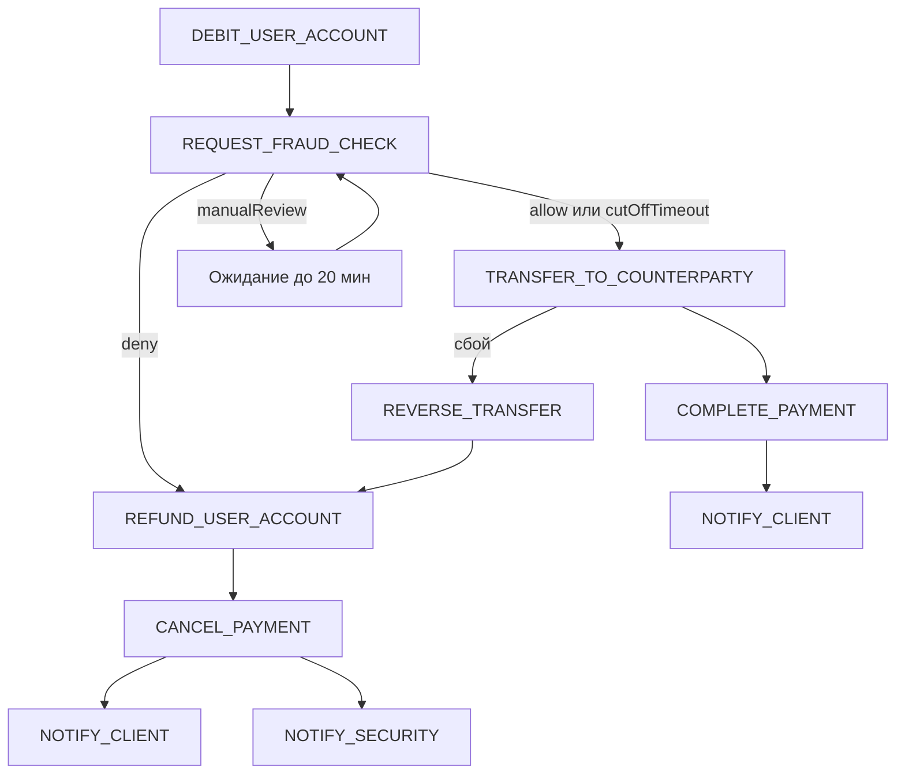

# Реестр транзакций Saga — OrchestrPay

Реестр шагов Saga-оркестрации платёжного процесса на маркетплейсе. Источник: описание бизнес-процесса OrchestrPay (Payment Service, FraudCheck Service, Notification Service).

## Основной реестр

| Транзакция | Описание | Тип | Компенсация |
|---|---|---|---|
| CREATE_PAYMENT | Создание записи платежа и фиксация начального состояния Saga в Payment Service (PostgreSQL) | компенсируемая | CANCEL_PAYMENT |
| DEBIT_USER_ACCOUNT | Списание средств со счёта клиента | компенсируемая | REFUND_USER_ACCOUNT |
| REQUEST_FRAUD_CHECK | Запрос проверки в FraudCheck Service (allow / deny / manual review); при manual — ожидание решения оператора до 20 мин; при cut-off без ответа — трактуется как allow | повторяемая | — |
| TRANSFER_TO_COUNTERPARTY | Перевод средств контрагенту (продавцу на маркетплейсе) после успешной проверки | компенсируемая | REVERSE_TRANSFER |
| COMPLETE_PAYMENT | Финализация платежа: статус «успешно», закрытие Saga | необратимая | — |
| NOTIFY_CLIENT | Отправка уведомления клиенту о результате операции через Notification Service | повторяемая | — |
| NOTIFY_SECURITY | Уведомление команды безопасности при подозрительной или отклонённой операции | повторяемая | — |
| CANCEL_PAYMENT | Отмена платежа: перевод записи в терминальный статус «отменён/ошибка» | компенсируемая | — |
| REFUND_USER_ACCOUNT | Возврат списанных средств клиенту (компенсация списания) | необратимая | — |
| REVERSE_TRANSFER | Отмена перевода контрагенту (компенсация перевода) | необратимая | — |

## Порядок выполнения (happy path)

```
CREATE_PAYMENT → DEBIT_USER_ACCOUNT → REQUEST_FRAUD_CHECK → TRANSFER_TO_COUNTERPARTY → COMPLETE_PAYMENT → NOTIFY_CLIENT
```


## Сценарии компенсации

| Триггер | Последовательность компенсирующих шагов |
|---|---|
| FraudCheck вернул deny после списания | REFUND_USER_ACCOUNT → CANCEL_PAYMENT → NOTIFY_CLIENT → NOTIFY_SECURITY |
| Сбой после списания, до перевода контрагенту | REFUND_USER_ACCOUNT → CANCEL_PAYMENT → NOTIFY_CLIENT |
| Сбой после перевода контрагенту | REVERSE_TRANSFER → REFUND_USER_ACCOUNT → CANCEL_PAYMENT → NOTIFY_CLIENT |



## Примечания

1. **REQUEST_FRAUD_CHECK** — повторяемая: вызов идемпотентен по `paymentId`, поддерживает retry и кэширование результата в Redis. Ожидание manual review и срабатывание cut-off-time — часть этого шага, отдельными транзакциями не выделяются.

2. **COMPLETE_PAYMENT** — необратимая точка завершения: после успешного перевода и финализации откат через компенсацию перевода нежелателен с точки зрения бизнеса (средства уже у контрагента).

3. **REFUND_USER_ACCOUNT** и **REVERSE_TRANSFER** — компенсирующие шаги помечены как необратимые: их нельзя «отменить» без риска двойного возврата или списания; повторный вызов допустим только при идемпотентности операции.

4. **NOTIFY_CLIENT** и **NOTIFY_SECURITY** — повторяемые: дублирование уведомления допустимо, отдельная компенсация не требуется.

5. **Compliance-проверки и контроль лимитов** — вне скоупа проектной работы и в реестр не включены.

6. Требование «деньги не должны зависать между системами» обеспечивается обязательной парой **DEBIT_USER_ACCOUNT** → **REFUND_USER_ACCOUNT** при любом отказе или сбое после списания.
