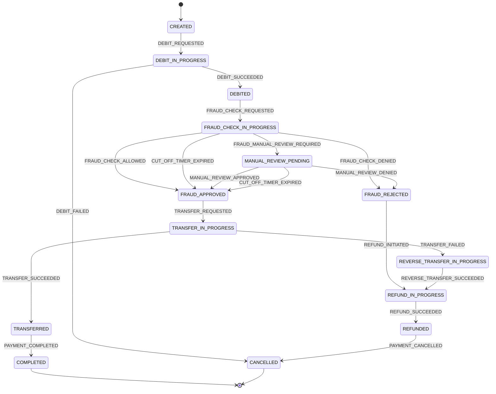

# Таблица переходов State Machine — OrchestrPay

State Machine описывает жизненный цикл платёжной операции: текущее состояние, события, инициирующие переход, и целевое состояние. Модель согласована с реестром Saga из Task 1 и бизнес-процессом OrchestrPay.

**Терминальные состояния:** `COMPLETED`, `CANCELLED`.

## Основная таблица переходов

| Исходное состояние | Переходное состояние | Событие |
|---|---|---|
| — | CREATED | PAYMENT_INITIATED |
| CREATED | DEBIT_IN_PROGRESS | DEBIT_REQUESTED |
| DEBIT_IN_PROGRESS | DEBITED | DEBIT_SUCCEEDED |
| DEBIT_IN_PROGRESS | CANCELLED | DEBIT_FAILED |
| DEBIT_IN_PROGRESS | CANCELLED | PAYMENT_CANCELLED |
| DEBITED | FRAUD_CHECK_IN_PROGRESS | FRAUD_CHECK_REQUESTED |
| DEBITED | REFUND_IN_PROGRESS | SYSTEM_ERROR_AFTER_DEBIT |
| FRAUD_CHECK_IN_PROGRESS | FRAUD_APPROVED | FRAUD_CHECK_ALLOWED |
| FRAUD_CHECK_IN_PROGRESS | FRAUD_REJECTED | FRAUD_CHECK_DENIED |
| FRAUD_CHECK_IN_PROGRESS | MANUAL_REVIEW_PENDING | FRAUD_MANUAL_REVIEW_REQUIRED |
| FRAUD_CHECK_IN_PROGRESS | FRAUD_APPROVED | CUT_OFF_TIMER_EXPIRED |
| FRAUD_CHECK_IN_PROGRESS | REFUND_IN_PROGRESS | SYSTEM_ERROR_AFTER_DEBIT |
| MANUAL_REVIEW_PENDING | FRAUD_APPROVED | MANUAL_REVIEW_APPROVED |
| MANUAL_REVIEW_PENDING | FRAUD_REJECTED | MANUAL_REVIEW_DENIED |
| MANUAL_REVIEW_PENDING | FRAUD_APPROVED | CUT_OFF_TIMER_EXPIRED |
| MANUAL_REVIEW_PENDING | REFUND_IN_PROGRESS | SYSTEM_ERROR_AFTER_DEBIT |
| FRAUD_APPROVED | TRANSFER_IN_PROGRESS | TRANSFER_REQUESTED |
| TRANSFER_IN_PROGRESS | TRANSFERRED | TRANSFER_SUCCEEDED |
| TRANSFER_IN_PROGRESS | REVERSE_TRANSFER_IN_PROGRESS | TRANSFER_FAILED |
| TRANSFER_IN_PROGRESS | REFUND_IN_PROGRESS | SYSTEM_ERROR_AFTER_TRANSFER |
| TRANSFERRED | COMPLETED | PAYMENT_COMPLETED |
| FRAUD_REJECTED | REFUND_IN_PROGRESS | REFUND_INITIATED |
| FRAUD_REJECTED | CANCELLED | PAYMENT_CANCELLED |
| REVERSE_TRANSFER_IN_PROGRESS | REFUND_IN_PROGRESS | REVERSE_TRANSFER_SUCCEEDED |
| REFUND_IN_PROGRESS | REFUNDED | REFUND_SUCCEEDED |
| REFUNDED | CANCELLED | PAYMENT_CANCELLED |

## Диаграмма состояний

## Сценарии (ответы на ключевые вопросы)

| Сценарий | Цепочка переходов |
|---|---|
| **Antifraud deny** | FRAUD_CHECK_IN_PROGRESS → FRAUD_REJECTED (`FRAUD_CHECK_DENIED`) → REFUND_IN_PROGRESS (`REFUND_INITIATED`) → REFUNDED → CANCELLED; параллельно отправляется NOTIFY_SECURITY |
| **Cut-off timer** | FRAUD_CHECK_IN_PROGRESS или MANUAL_REVIEW_PENDING → FRAUD_APPROVED (`CUT_OFF_TIMER_EXPIRED`) → TRANSFER_IN_PROGRESS → TRANSFERRED → COMPLETED |
| **Подтверждение (allow)** | FRAUD_CHECK_IN_PROGRESS → FRAUD_APPROVED (`FRAUD_CHECK_ALLOWED`) → TRANSFER_IN_PROGRESS → TRANSFERRED → COMPLETED |
| **Ручная проверка** | FRAUD_CHECK_IN_PROGRESS → MANUAL_REVIEW_PENDING (`FRAUD_MANUAL_REVIEW_REQUIRED`) → FRAUD_APPROVED (`MANUAL_REVIEW_APPROVED`) или FRAUD_REJECTED (`MANUAL_REVIEW_DENIED`) |
| **Happy path** | CREATED → DEBIT_IN_PROGRESS → DEBITED → FRAUD_CHECK_IN_PROGRESS → FRAUD_APPROVED → TRANSFER_IN_PROGRESS → TRANSFERRED → COMPLETED |
| **Сбой после списания** | DEBITED / FRAUD_CHECK_IN_PROGRESS / MANUAL_REVIEW_PENDING → REFUND_IN_PROGRESS (`SYSTEM_ERROR_AFTER_DEBIT`) → REFUNDED → CANCELLED |
| **Сбой при переводе** | TRANSFER_IN_PROGRESS → REVERSE_TRANSFER_IN_PROGRESS (`TRANSFER_FAILED`) → REFUND_IN_PROGRESS → REFUNDED → CANCELLED |

## Связь состояний с шагами Saga (Task 1)

| Состояние SM | Соответствующий шаг Saga |
|---|---|
| CREATED | CREATE_PAYMENT |
| DEBIT_IN_PROGRESS → DEBITED | DEBIT_USER_ACCOUNT |
| FRAUD_CHECK_IN_PROGRESS / MANUAL_REVIEW_PENDING | REQUEST_FRAUD_CHECK |
| TRANSFER_IN_PROGRESS → TRANSFERRED | TRANSFER_TO_COUNTERPARTY |
| COMPLETED | COMPLETE_PAYMENT |
| REFUND_IN_PROGRESS → REFUNDED | REFUND_USER_ACCOUNT |
| REVERSE_TRANSFER_IN_PROGRESS | REVERSE_TRANSFER |
| CANCELLED | CANCEL_PAYMENT |

## Примечания

1. **CUT_OFF_TIMER_EXPIRED** — при отсутствии ответа от сервисов проверок в установленное время платёж по умолчанию считается разрешённым и переходит в `FRAUD_APPROVED`.

2. **MANUAL_REVIEW_PENDING** — транзакция ожидает решения оператора в течение 20 минут. Оператор возвращает allow (`MANUAL_REVIEW_APPROVED`) или deny (`MANUAL_REVIEW_DENIED`).

3. **NOTIFY_CLIENT** и **NOTIFY_SECURITY** — побочные эффекты Saga; состояние платежа при их выполнении не меняется.

4. **SYSTEM_ERROR_AFTER_DEBIT** и **SYSTEM_ERROR_AFTER_TRANSFER** — инициируют автоматическую компенсацию (возврат средств) без участия службы поддержки.

5. Compliance-проверки и контроль лимитов — вне скоупа проектной работы.
