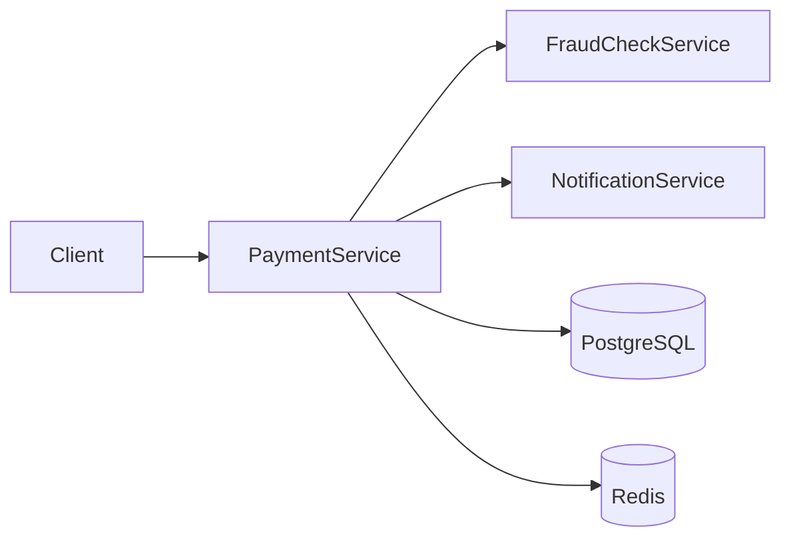
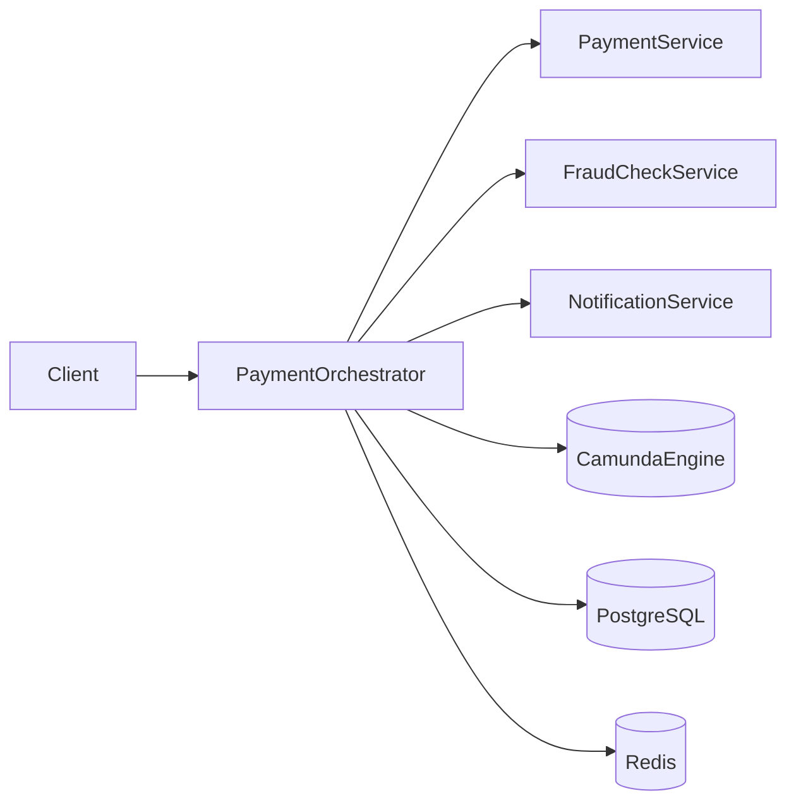

# ADR-001: Размещение Saga-оркестратора платёжного процесса

## Общая информация

1. **Родительский артефакт** — [main_info.md](../main_info.md), [Task1/saga_transactions_registry.md](../Task1/saga_transactions_registry.md), [Task2/payment_state_transitions.md](../Task2/payment_state_transitions.md)
2. **Автор ADR** — команда архитектуры OrchestrPay
3. **Статус** — Принят
4. **Согласующие** — Lead Payment Service, Lead FraudCheck Service, DevOps/SRE, Security

## Контекст

OrchestrPay реализует платёжный процесс на маркетплейсах через Saga-оркестрацию. В рамках одной транзакции задействованы Payment Service, FraudCheck Service и Notification Service. Процесс включает списание средств, антифрод-проверку (allow / deny / manual review), перевод контрагенту и автоматические компенсации при отказе или сбое.

На предыдущих этапах проектирования зафиксированы шаги Saga (Task 1) и State Machine платежа (Task 2). Следующий архитектурный вопрос — **где разместить функцию оркестрации**: внутри одного из доменных сервисов или в отдельном сервисе-оркестраторе.

К решению относятся следующие требования:

- Сложный workflow: компенсирующие транзакции, ожидание ручной проверки до 20 минут, cut-off-time при отсутствии ответа от проверок.
- State machine для управления Saga: фиксация текущего состояния, восстановление после ошибок.
- Мониторинг и трассировка: прозрачный обзор этапов транзакции, включая «зависшие» операции.
- Критичное требование: деньги не должны зависать между системами; возвраты выполняются автоматически.
- В технологическом стеке заявлен **Camunda BPMN** для исполнения бизнес-процессов и Saga-оркестрации с поддержкой компенсационных транзакций.

## Рассмотренные варианты

### Вариант №1 «Оркестрация внутри Payment Service»

Payment Service становится центральным координатором Saga. Он принимает запрос на платёж, хранит состояние процесса в PostgreSQL, управляет переходами State Machine, вызывает FraudCheck Service и Notification Service, инициирует компенсации (возврат средств, отмена платежа). Промежуточные статусы и результаты проверок кэшируются в Redis.

Payment Service совмещает доменную логику (debit, transfer, refund) и логику оркестрации (последовательность шагов, таймеры, compensation).

### Вариант №2 «Отдельный Payment Orchestrator Service (Camunda)»

Выделяется отдельный сервис-оркестратор с Camunda BPMN Engine. Оркестратор исполняет Saga-процесс по модели, зафиксированной в Task 1–2, и делегирует доменные операции специализированным сервисам через API. Payment Service отвечает за финансовые операции, FraudCheck — за проверки, Notification — за уведомления. Состояние процесса и history хранятся в Camunda (PostgreSQL); промежуточные данные — в Redis.

## Сравнение альтернатив

| Вариант решения | Преимущества | Недостатки |
|---|---|---|
| Вариант №1 «Оркестрация внутри Payment Service» | - Меньше сервисов в инфраструктуре - Меньше сетевых hop, потенциально ниже latency - Проще старт MVP: одна точка входа для платежа - Не требует отдельной эксплуатации Camunda | - Payment Service превращается в «god service» - Смешение доменной логики платежа и координации чужих bounded context - Сложнее независимо менять workflow без релиза Payment Service - Размываются границы ответственности между командами (Payment, FraudCheck, Notification) - Хуже масштабируется при добавлении новых проверок (compliance, лимиты) - Мониторинг этапов Saga смешивается с доменной логикой |
| Вариант №2 «Отдельный Payment Orchestrator Service (Camunda)» | - Чёткое разделение orchestration vs domain logic - BPMN-модель процесса прозрачна для бизнеса и SRE - Нативная поддержка compensation и long-running wait (manual review, cut-off) - Независимое масштабирование и деплой workflow - Единая точка мониторинга этапов Saga (Camunda Cockpit, history) - Соответствует заявленному tech stack (Camunda BPMN) - Payment Service остаётся focused на debit/transfer/refund | - Дополнительный серvice и инфраструктура - Дополнительные сетевые вызовы между сервисами - Operational complexity: развёртывание и поддержка Camunda - Требуется distributed tracing и идемпотентность команд между сервисами |

## Принятое решение

**Вариант №2 «Отдельный Payment Orchestrator Service (Camunda)».**

**Обоснование:**

1. **Сложность процесса.** Платёжная Saga включает 10+ шагов, компенсации, ожидание ручной проверки до 20 минут и cut-off-time. Такая координация выходит за рамки ответственности одного доменного сервиса.

2. **Соответствие tech stack.** Camunda BPMN уже выбран командой для Saga-оркестрации. Логично разместить engine в выделенном orchestrator, а не встраивать в Payment Service.

3. **State machine и мониторинг.** Требование фиксировать состояние процесса и видеть, на каком этапе «зависла» транзакция, лучше реализуется на стороне оркестратора через Camunda history и Cockpit.

4. **Разделение ответственности.** Payment Service остаётся focused на финансовых операциях (debit, transfer, refund). FraudCheck и Notification развиваются независимыми командами — оркестратор координирует их без поглощения логики в Payment Service.

5. **Согласованность с Task 1–2.** Оркестратор исполняет реестр транзакций Saga и переходы State Machine, не смешивая workflow с доменной реализацией шагов.

**Принятые компромиссы:**

- Принимаем operational overhead Camunda как плату за прозрачность и управляемость сложного процесса.
- Обеспечиваем идемпотентность команд (по `paymentId`) и distributed tracing между orchestrator и domain services для соблюдения SLA (< 5 сек в p90 для успешных транзакций).
