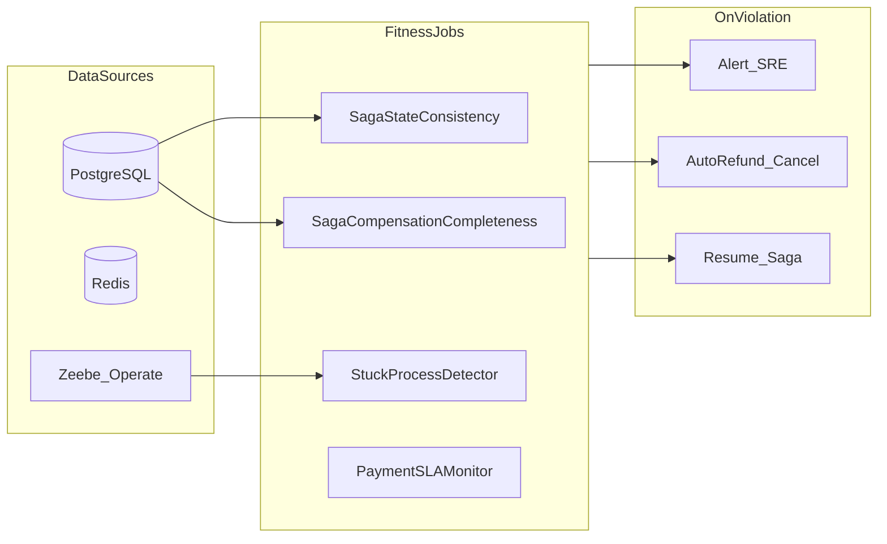

# Fitness-функции — OrchestrPay

Автоматические проверки архитектурной и операционной «пригодности» (fitness) платёжной платформы. Обеспечивают консистентность данных между микросервисами, выявление зависших процессов, целостность Saga и контроль таймаутов.

**Источники:** [Task1](../Task1/saga_transactions_registry.md), [Task2](../Task2/payment_state_transitions.md), [Task3 ADR](../Task3/ADR-001-orchestrator-placement.md), [Task4.2](../Task4/Task4.2/), [Task5](../Task5/integration_e2e_test_cases.md), [main_info.md](../main_info.md).

---

## Основная таблица fitness-функций

| Название функции | Назначение | Что проверяется | Действие при нарушении | Способ реализации |
|---|---|---|---|---|
| SagaStateConsistency | Консистентность состояний Saga | Записи в `saga_states` / `payments` без терминального статуса (`COMPLETED`, `CANCELLED`) дольше порогового времени (30 мин) | Восстановление состояния SM или эскалация в SRE | Scheduled job (cron), SQL-запрос к PostgreSQL |
| CrossServiceStateAlignment | Согласованность данных между микросервисами | Поле `payment.state` в Payment Service (PostgreSQL) соответствует активному шагу process instance в Zeebe (Operate) для того же `paymentId` | Синхронизация состояния или отмена process instance | Scheduled job + Zeebe REST API + SQL join по `paymentId` |
| FraudResultCacheConsistency | Консистентность FraudCheck и Redis | Результат проверки в Redis для `paymentId` совпадает с последним ответом FraudCheck Service (audit log) | Инвалидация кэша, повторный запрос проверки | Cron job: сравнение Redis vs FraudCheck audit table |
| StuckProcessDetector | Выявление зависших процессов | Process instances в Zeebe без прогресса > N минут (incident или незавершённый job) | Alert в SRE; retry job или cancel process instance | Zeebe Operate API + Prometheus alert (Alertmanager) |
| ManualReviewStuckGuard | Зависшие процессы на ручной проверке | Платежи в состоянии `MANUAL_REVIEW_PENDING` > 20 мин без события `MANUAL_REVIEW_APPROVED` / `MANUAL_REVIEW_DENIED` / `CUT_OFF_TIMER_EXPIRED` | Принудительный cut-off (allow) или эскалация оператору Security | Zeebe timer boundary (PT20M) + watchdog scheduled job |
| PaymentProcessingTimeout | Контроль долго выполняющихся платежей | Платежи не в терминальном статусе дольше 30 минут | Автоматический REFUND, CANCEL_PAYMENT, NOTIFY_CLIENT | Cron job: поиск в БД по `updated_at` и статусу NOT IN (COMPLETED, CANCELLED) |
| SagaCompensationCompleteness | Целостность Saga-транзакций (компенсация) | После `DEBITED` и перехода в `FRAUD_REJECTED` / `CANCELLED` отсутствует успешная запись `REFUND_USER_ACCOUNT` | Запуск compensation workflow (REFUND → CANCEL → NOTIFY) | Scheduled reconciliation job по audit log Saga |
| OrphanedDebitDetector | Целостность Saga (зависшие списания) | Debit выполнен, терминального состояния нет, refund отсутствует | Автоматический `REFUND_USER_ACCOUNT` | SQL: `debit_log` JOIN `payments` WHERE state NOT IN (COMPLETED, CANCELLED, REFUNDED) |
| DuplicateRefundGuard | Целостность Saga (идемпотентность refund) | Более одного успешного REFUND на один `paymentId` | Блокировка повторного refund; critical alert | Idempotency key + уникальный индекс в audit table |
| SagaTerminalStateIntegrity | Целостность Saga (конечные состояния) | Все завершённые Saga находятся только в `COMPLETED` или `CANCELLED`; нет недопустимых переходов SM | Audit log, alert архитектору | ArchUnit (SM validator) + CHECK constraint в PostgreSQL |
| FraudCheckCutoffEnforcement | Контроль таймаутов FraudCheck | `FRAUD_CHECK_IN_PROGRESS` без ответа дольше cut-off (5 мин в прототипе Task 4.2) | Триггер события `CUT_OFF_TIMER_EXPIRED` → переход к allow | Zeebe timer boundary + watchdog job |
| PaymentSLAMonitor | Контроль SLA бизнес-процесса | p90 end-to-end latency успешного платежа > 5 секунд | Alert DevOps/SRE | Prometheus histogram (`payment_duration_seconds`) + Grafana alert |
| ZeebeJobActivationTimeout | Контроль дедлайнов job workers | Jobs без completion дольше activation timeout | Incident в Zeebe; автоматический retry | Zeebe metrics (`zeebe_job_lifetime`) + Alertmanager |
| MoneyReconciliationFitness | Контроль «деньги не зависают» | Для незавершённых платежей: debit − refund − transfer_to_counterparty ≠ 0 | Автокомпенсация + critical alert Finance/SRE | Reconciliation batch job (ежечасный) |

---

## Группировка по категориям

### Консистентность данных между микросервисами
- SagaStateConsistency
- CrossServiceStateAlignment
- FraudResultCacheConsistency

### Выявление зависших процессов
- StuckProcessDetector
- ManualReviewStuckGuard
- PaymentProcessingTimeout

### Целостность Saga-транзакций
- SagaCompensationCompleteness
- OrphanedDebitDetector
- DuplicateRefundGuard
- SagaTerminalStateIntegrity

### Контроль таймаутов и дедлайнов
- FraudCheckCutoffEnforcement
- PaymentSLAMonitor
- ZeebeJobActivationTimeout
- MoneyReconciliationFitness

---

## Архитектура fitness-проверок

---

## Связь с тест-кейсами Task 5

| Fitness-функция | Связанный тест-кейс |
|---|---|
| SagaStateConsistency, CrossServiceStateAlignment | TC-15 |
| OrphanedDebitDetector, MoneyReconciliationFitness | TC-19 |
| StuckProcessDetector, PaymentSLAMonitor | TC-20 |
| ManualReviewStuckGuard, FraudCheckCutoffEnforcement | TC-06, TC-07 |
| SagaCompensationCompleteness | TC-08, TC-10 |
| DuplicateRefundGuard | TC-14 |
| PaymentProcessingTimeout | TC-11 (адаптация: 30 мин vs мгновенный debit fail) |

---

## Примечания

1. **SagaStateConsistency** и **PaymentProcessingTimeout** — из примера [task6.md](task6.md), адаптированы под State Machine OrchestrPay (Task 2) и PostgreSQL.

2. **Пороги времени:** manual review — 20 мин; общий timeout платежа — 30 мин; cut-off FraudCheck — 5 мин (прототип Task 4.2); SLA — 5 сек p90 ([main_info.md](../main_info.md)).

3. **Инструменты:** scheduled jobs (Kubernetes CronJob), Prometheus + Grafana, Camunda Operate API, Zeebe metrics, ArchUnit для SM-ограничений.

4. **Принцип «деньги не зависают»:** `OrphanedDebitDetector`, `SagaCompensationCompleteness` и `MoneyReconciliationFitness` работают совместно — при нарушении инициируется автоматический refund без участия Customer Support.

5. Compliance-проверки и лимиты — вне скоупа fitness-функций проектной работы.
